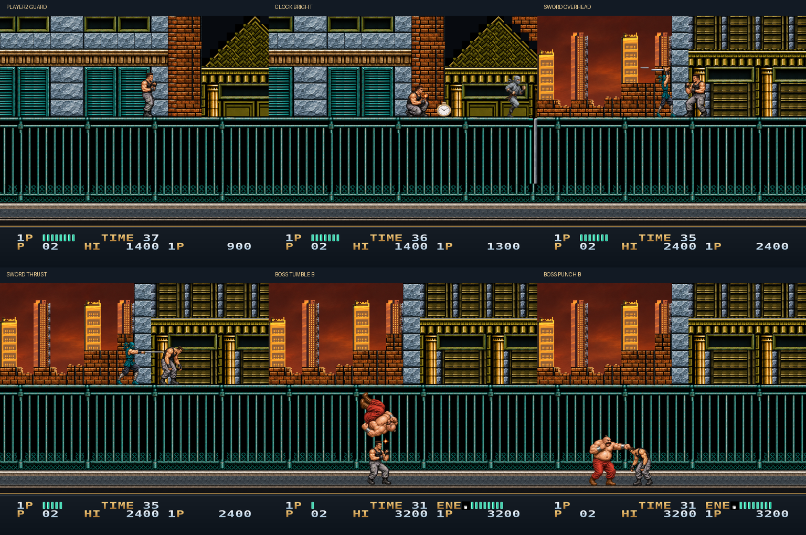

# Bad Dudes HD

A work-in-progress **4x HD graphics pack** for Bad Dudes (NES), built for MesenCE.

## Current build: v0.5.1

This patch fills the black squares in the truck tires and keeps the wheel
size consistent through every mapped animation phase. The cab now uses the
same emerald finish across both scrolling banks, including its roof, rear
panel and window. It reuses the existing approved artwork.

A **Level 1 and Level 2 test build**, with the approved character artwork reused
throughout. Level 2 adds a painted city/highway, moving silver and emerald
trucks, small blue ninjas and the armored claw boss.

Both heroes now have dagger and nunchaku guards, standing/crouched attacks,
overhead attacks and the two-arm victory pose. Additional red-ninja poses
stay HD, and weapon pickups keep their artwork during the bright flash cycle.
GO TO NEXT STAGE and stage-clear lettering are taller and outlined for contrast.
The live HUD panel works in Level 2, with both player labels still gold.

The full 8,850-frame Level 2 recording has detailed mappings for every observed
visible gameplay sprite tile/palette key. The earlier red-ninja and missed
super-punch clips remain pixel-identical to v0.4.2. Unrecorded moves, alternating
two-player states and later levels still need testing. This is not a complete
full-game release.

## Install

Load your own **Bad Dudes (USA).nes** in MesenCE, then choose
**Tools > HD Packs (NES) > Install HD Pack** and select the install ZIP.
Enable HD packs in NES settings and reload the game if needed.

For manual installation, copy the contents of `pack/` into
`HdPacks/Bad Dudes (USA)/`. The folder name must match your ROM's base filename.
All eight PNGs and `hires.txt` must be together. This repository's Code > Download
ZIP also contains an installable `pack/hires.txt` directory.

Tested with MesenCE 2.2.1. No ROM, emulator or movie recording is included.
The pack changes presentation; gameplay and music are unchanged.

## Development

Approved checkpoints are accumulated on `develop`. Keep `main` at the current
baseline until the full remake and final regression testing are complete,
then merge `develop` and create the v1.0.0 release. The v0.4.2 checkpoint is
approved for this development branch; it is not a full-game release.

See [DEVELOPMENT.md](DEVELOPMENT.md) for build setup, tile mapping, validation
and the next art pass. `art/` contains the source illustrations; `scripts/`
assembles them into `pack/`; `metadata/` holds the captured tile mappings.
The source ROM is required to rebuild and must remain outside this repository.
