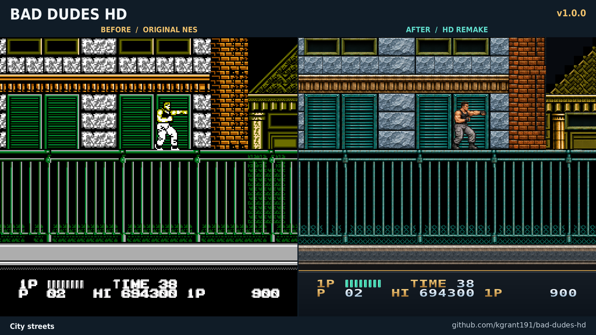
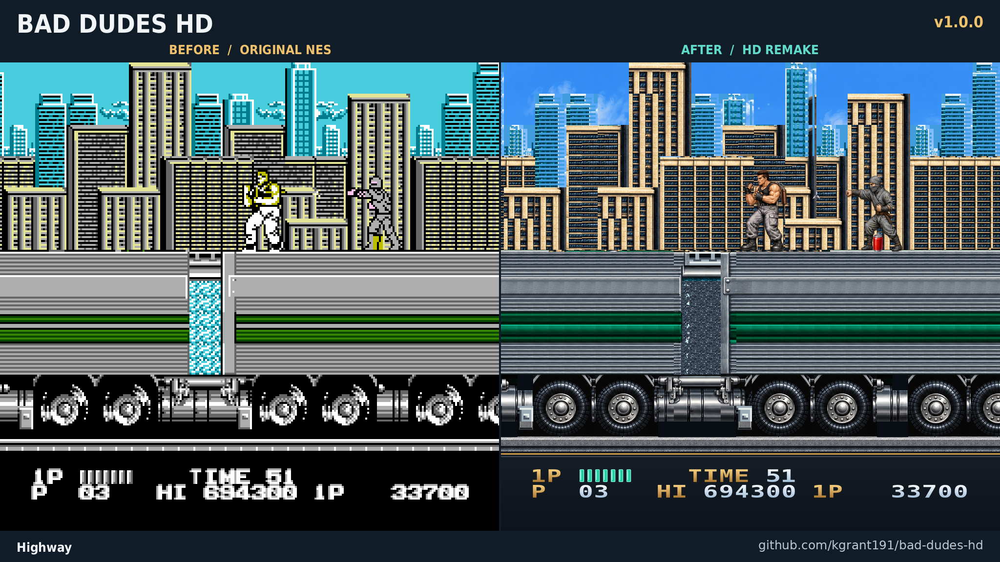
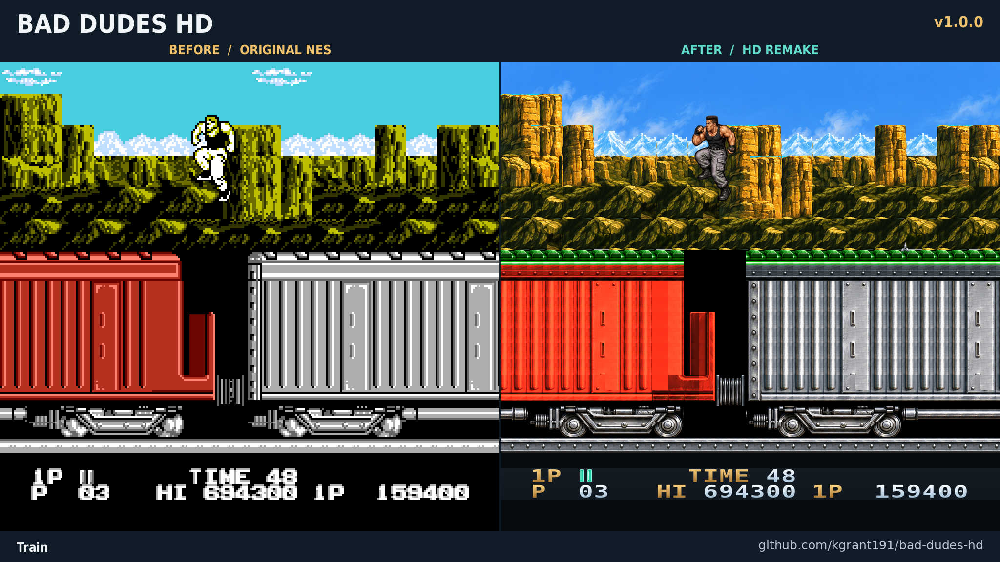
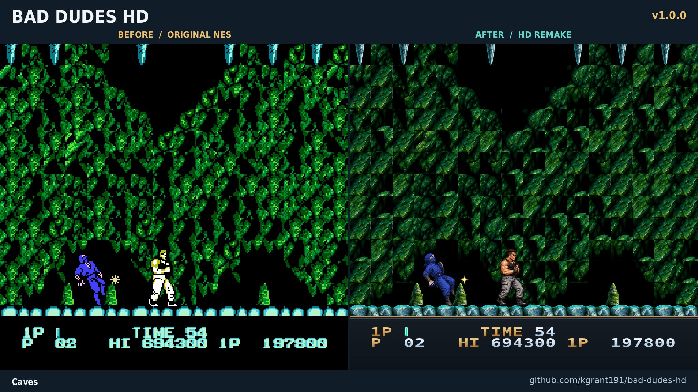

# Bad Dudes HD

A **4x HD graphics pack for Bad Dudes (NES)**, built for MesenCE. Play the
original game with detailed characters, enemies and environments across all
seven stages. Gameplay, collisions, timing and music stay controlled by the game.

**[Download the HD pack](https://github.com/kgrant191/bad-dudes-hd/releases)**

## Before and after

Original NES on the left; Bad Dudes HD on the right. Each pair comes from the
same frame of the same recorded playthrough.

## What's included in v1.0.0

- All seven stages, including the moving trucks, train, caves, final factory
  and helicopter battle.
- Distinct artwork for both playable heroes, including their weapons,
  effects and palette variants.
- Detailed enemies and bosses, with attack, recoil and defeat states.
- Illustrated title, selection, briefing and ending screens.
- Updated HUD, menus and live credit lettering, with HD art retained through
  the game's palette fades.

Ending figures and flags are still illustrations; dialogue and scrolling
credits remain live. Original damage blinking, sprite limits and clipping are
preserved.

## Install

Tested with **MesenCE 2.2.1** and **Bad Dudes (USA).nes**.

1. Download `Bad_Dudes_HD_v1.0.0.zip` from Releases.
2. Open your own Bad Dudes (USA) ROM in MesenCE.
3. Choose **Tools > HD Packs (NES) > Install HD Pack** and select the ZIP.
4. Enable HD packs in NES settings and reload the game if needed.

For manual installation, place `hires.txt`, `README.txt` and all eleven PNGs
together in `HdPacks/Bad Dudes (USA)/`. The folder name must match your ROM's
base filename. When updating, replace the previous pack's files.

The install ZIP contains only the HD pack. No ROM, emulator or movie recording
is included. GitHub's **Code > Download ZIP** also contains the installable
`pack/` directory, along with development files.

## Development

The release uses the approved v0.11.0 artwork and mappings. The final regression
covered a full second-character playthrough, the complete ending and return to
menus, a separate game-over recording, and a final cave replay. Evidence and
recorded-state limits are in `validation/`.

See [DEVELOPMENT.md](DEVELOPMENT.md) for build setup and
[RELEASE_NOTES.md](RELEASE_NOTES.md) for the release notes. `art/` contains source
illustrations, `scripts/` builds the pack, and `metadata/` holds tile mappings.
The source ROM is required to rebuild and must remain outside this repository.
